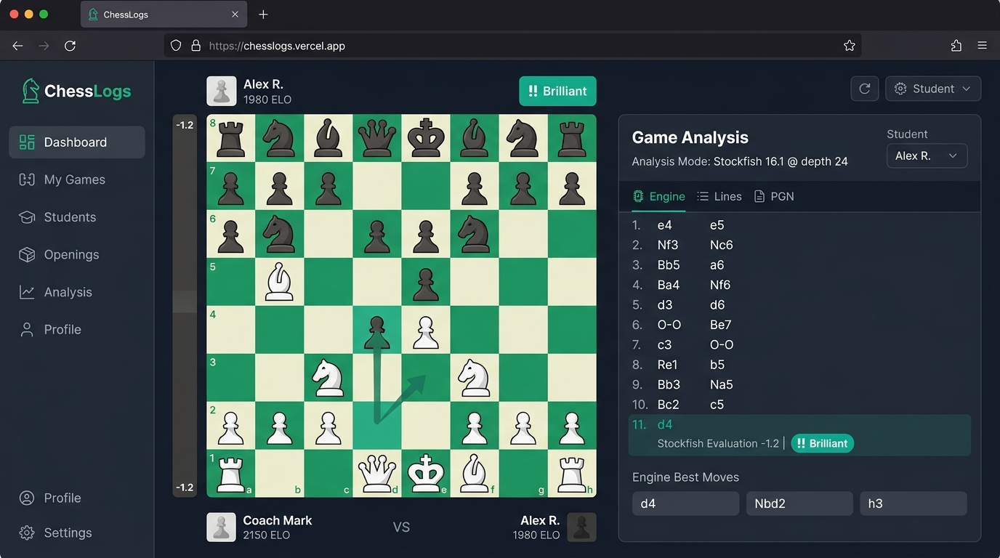

# ChessLogs

Coach–student LMS for chess improvement: assigned courses, Chess.com game sync, and Stockfish-powered game review.

[](https://chesslogs.vercel.app)

> **Live Deployment**: [https://chesslogs.vercel.app](https://chesslogs.vercel.app)

## Tech stack

- **Frontend**: React (Vite, JavaScript) + React Router + Tailwind CSS
- **Lint/format**: ESLint (`eslint:recommended` + `eslint-plugin-react` + `eslint-plugin-react-hooks`) + Prettier
- **Backend**: PHP REST API (PDO MySQL / MariaDB). Also provides local offline fallback.
- **Database**: MySQL / MariaDB (`chesslogs`)
- **Chess**: `chess.js`, `react-chessboard`, Stockfish 18 NNUE via Web Worker (`public/stockfish/`)
- **CLI Database Guide**: See [MYSQL_CLI_GUIDE.md](MYSQL_CLI_GUIDE.md)

## Important constraints

### 1. Chess.com login is not open OAuth

Chess.com’s Public API (`api.chess.com/pub/`) is unauthenticated and read-only — it does **not** prove the visitor owns a username. True “Login with Chess.com” requires Chess.com’s OAuth partner program (manual approval).

**What ChessLogs does today**

- Identity: Supabase email/password + Google OAuth
- Users **link** a Chess.com username during onboarding (trusted self-declare for MVP, with optional bio-code verification)
- Games/ratings come from the Public API — no API key needed
- Feature flag: `VITE_CHESSCOM_OAUTH_ENABLED` (default `false`). Set to `true` later if/when partner OAuth is approved. See `src/config/engine.js`.

### 2. Stockfish parity with Chess.com is approximate

Chess.com uses Stockfish 16 for fast Game Review classifications and Stockfish 18 for deep Analysis. Exact search parameters are not published.

ChessLogs uses the latest official Stockfish WASM (NNUE) with two modes in `src/config/engine.js`:

| Mode | Purpose |
|------|---------|
| `fastReview` | Lower depth/time — full-game move classifications |
| `deepAnalysis` | Higher depth/time — single-position deep dive |

Evaluations will be **close but not identical** to Chess.com due to undisclosed server-side tuning.

## Features

| Area | Notes |
|------|--------|
| Auth & roles | `admin` (coach) vs `student`; RLS in `supabase/schema.sql`; admin seeded via `scripts/seed_admin.js` |
| Profile | Display name, avatar, linked Chess.com username + Public API stats |
| Dashboard | Courses, recent reviews, rating snapshot |
| Games | Client-triggered Chess.com monthly archive sync + filters |
| Analysis | Board, eval bar, best-move arrows, Brilliant→Blunder labels, deep analysis toggle |
| Courses | Video embeds or Chessable-style walkthrough chapters; admin builder + assign |
| Admin | Student roster, course CRUD, assign, drill into student games |

## Setup & Running

### 1. Install & Configure

```bash
npm install
cp .env.example .env
```

Ensure your `.env` contains the database credentials (default for XAMPP):
```env
DB_HOST=127.0.0.1
DB_PORT=3306
DB_NAME=chesslogs
DB_USER=root
DB_PASS=
```

### 2. Database Migration

Ensure MySQL is running (e.g. start MySQL in XAMPP Control Panel), then run:

```bash
npm run db:migrate
```
*(Or `php database/migrate.php` / `mysql -u root chesslogs < database/schema.sql`)*

This creates the `chesslogs` database, all 9 tables, indexes, constraints, and seeds the default Admin account:
- **Admin Email**: `satoalt33@gmail.com`
- **Admin Password**: `ChessLogsAdmin2026!`

### 3. Run Backend & Frontend

Start the PHP backend (runs on port 8000):
```bash
npm run backend
```
*(Runs `php -S 127.0.0.1:8000 api/router.php`)*

In another terminal, start the Vite frontend (runs on port 3000, proxies `/api` to 8000):
```bash
npm run dev
```

### 4. Viewing the Database via MySQL CLI

For complete instructions and examples, see **[MYSQL_CLI_GUIDE.md](MYSQL_CLI_GUIDE.md)**.
Quick command:
```bash
mysql -u root chesslogs
```
or via full XAMPP path in PowerShell:
```powershell
& "C:\xampp\mysql\bin\mysql.exe" -u root chesslogs
```

### 4. Quality gates

```bash
npm run lint
npm run build
```

## Deploy (GitHub + Vercel)

```bash
gh auth login
vercel login

git add .
git commit -m "Initial commit: ChessLogs MVP"
# If the GitHub repo already exists, push instead of create:
git push -u origin main

vercel link --yes
vercel env add VITE_SUPABASE_URL production
vercel env add VITE_SUPABASE_ANON_KEY production
vercel --prod
```

Connect the GitHub repo to the Vercel project so pushes to `main` auto-deploy.

## Project layout

```
src/
  pages/           # Dashboard, Games, Analysis, Courses, Admin, Profile, Auth
  components/      # Board, eval bar, navbar, badges
  lib/             # db, chesscom Public API, Stockfish engine wrapper
  config/engine.js # fastReview / deepAnalysis / Chess.com OAuth flag
supabase/schema.sql
scripts/seed_admin.js
public/stockfish/  # WASM worker assets
```

## License

Private / unlicensed unless otherwise stated.
